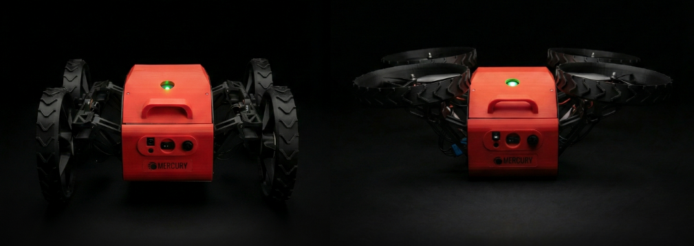
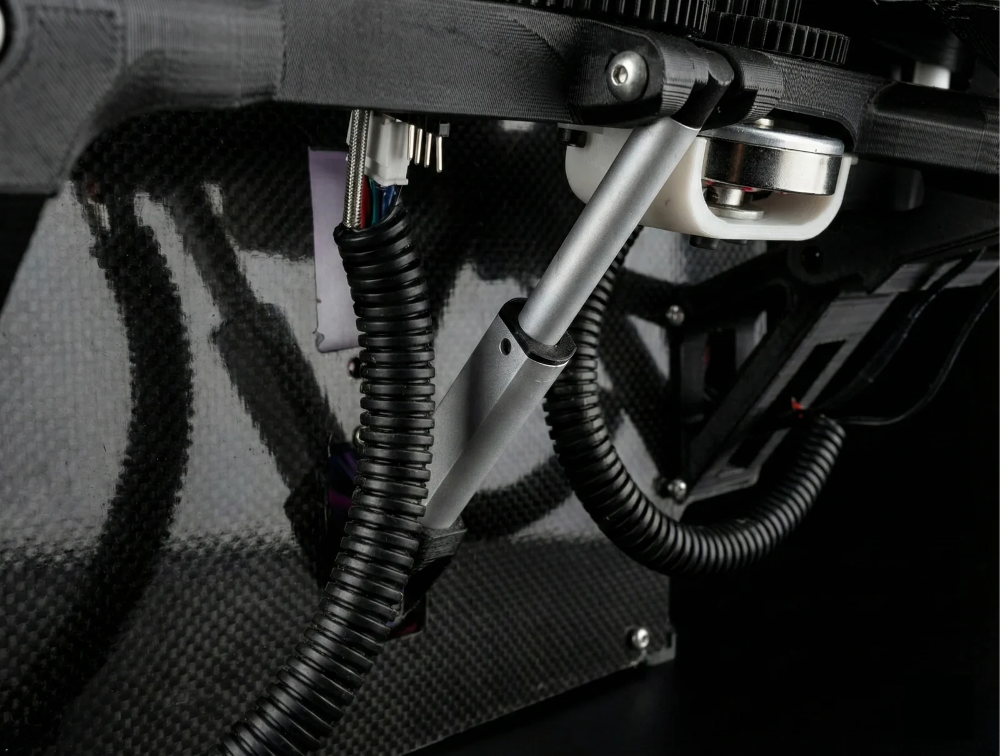
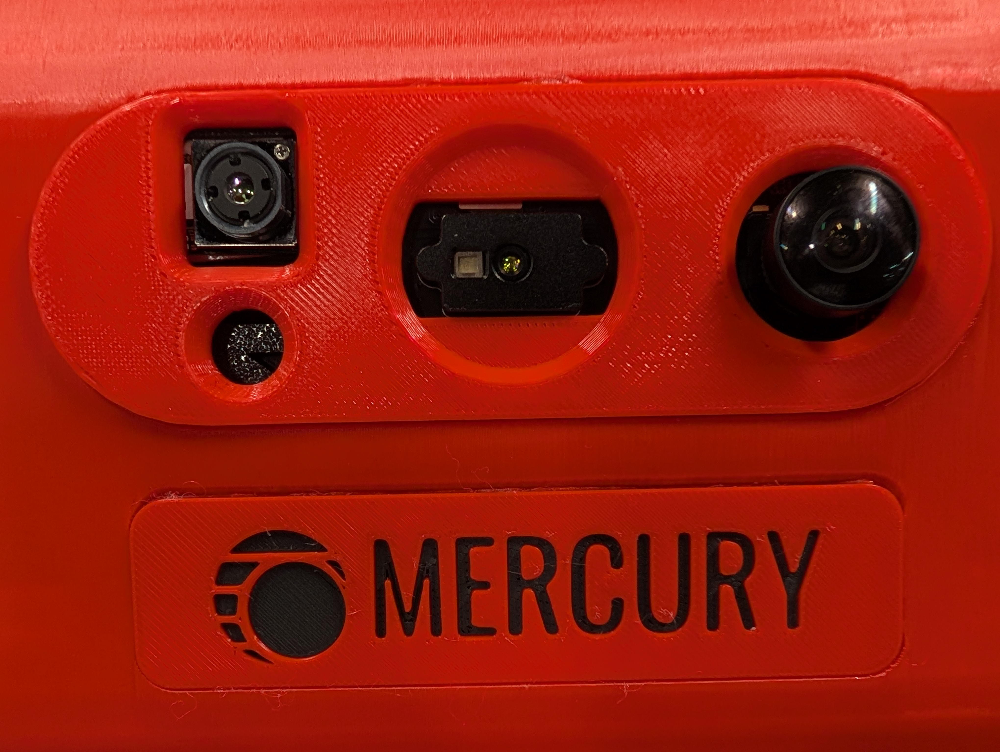
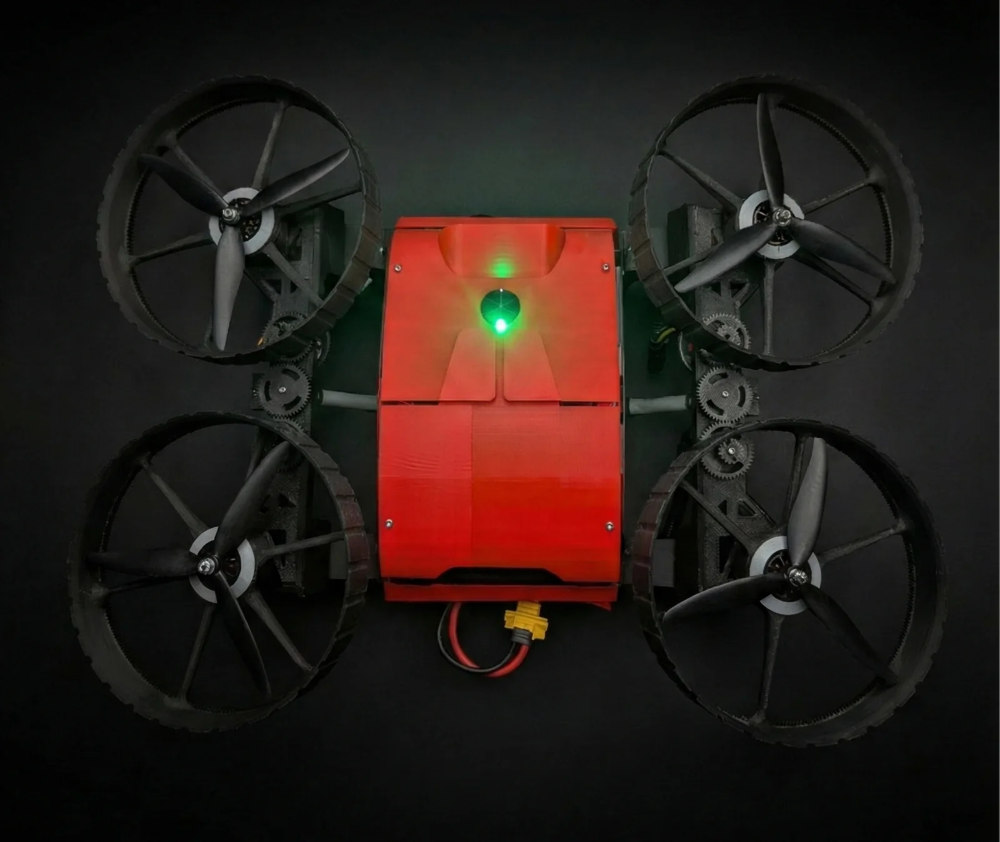
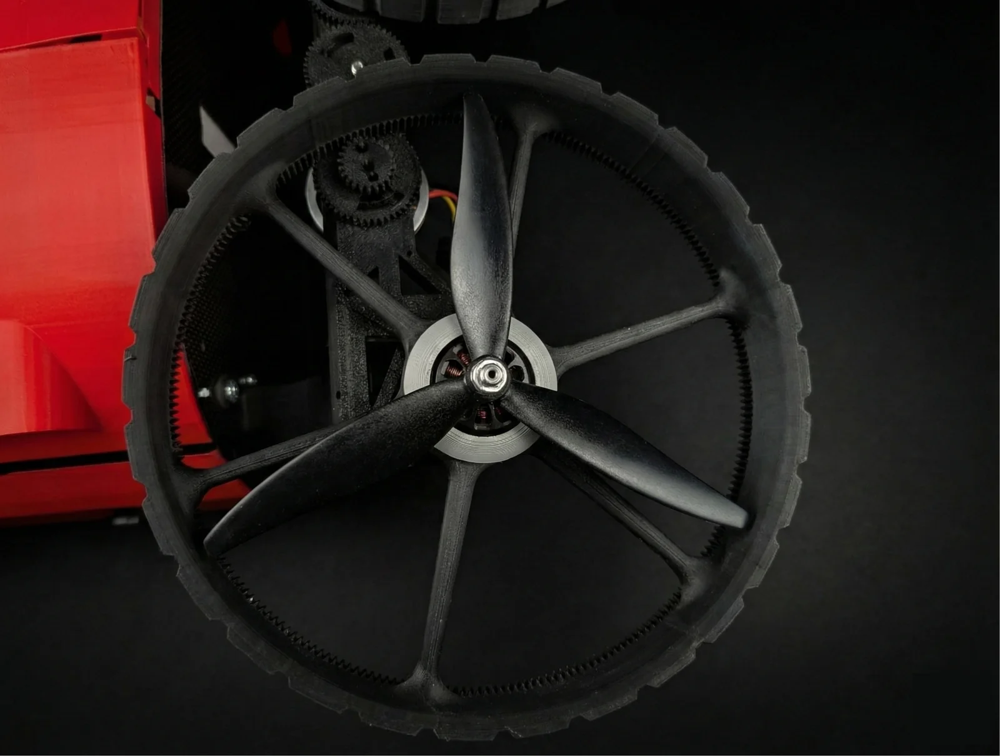
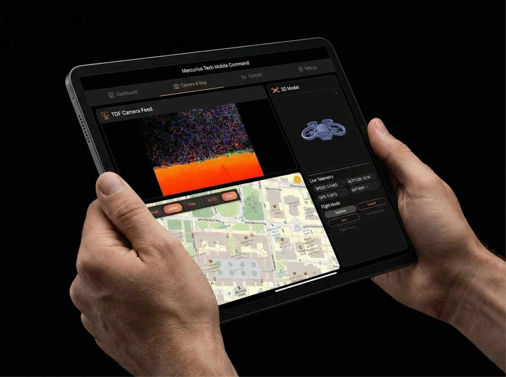
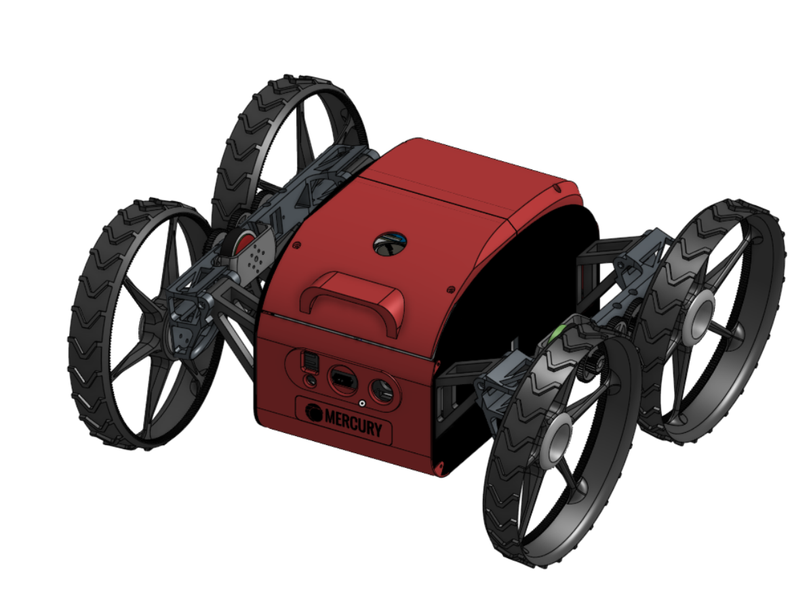

# MERCURY——可变形无人机
<!-- 硬件与平台 -->




[](https://buymeacoffee.com/mercuriustech)
[](https://www.patreon.com/c/MercuriusTech)
[](https://x.com/L42ARO)
[](https://discord.gg/ZudrWv6E)


## 快速索引

- [演示视频](#演示视频)
- [原版功能](#原版功能)
- [目录结构](#目录结构)
- [原版物料清单](#原版物料清单)
- [原版 CAD 与打印文件](#原版-cad-与打印文件)
- [无碳板承力电子舱](#无碳板承力电子舱本地改型)
- [软件安装与运行](#软件安装与运行)
- [STM32 履带电机控制台架记录](STM32-Motor-Control.md)
- [中文资料与本地化约定](#中文资料与本地化约定)
- [许可证](#许可证)

## 演示视频

[](https://youtu.be/DZhdSxqXiKo)

## 原版功能

<table width="100%">
  <tr>
    <td width="50%" align="center"><b>原版内置货舱（1 kg）</b></td>
    <td width="50%" align="center"><b>简易变形机构</b></td>
  </tr>
  <tr>
    <td width="50%" align="center"></td>
    <td width="50%" align="center"></td>
  </tr>
</table>

<table width="100%">
  <tr>
    <td width="50%" align="center"><b>彩色、深度与热成像摄像头</b></td>
    <td width="50%" align="center"><b>ArduPilot 飞控与 GPS 定位</b></td>
  </tr>
  <tr>
    <td width="50%" align="center"></td>
    <td width="50%" align="center"></td>
  </tr>
</table>

<table width="100%">
  <tr>
    <td width="50%" align="center"><b>车轮兼螺旋桨保护圈</b></td>
    <td width="50%" align="center"><b>移动端控制应用</b></td>
  </tr>
  <tr>
    <td width="50%" align="center"></td>
    <td width="50%" align="center"></td>
  </tr>
</table>

## 目录结构

- **STL Files**：原版无人机装配所需的 STL 打印模型及侧板图纸。
- **Electronics Bay**：本地改型的电子舱、配套肩座、中文图表、验证报告与生成脚本。
- **Autonomy Software**：自主控制与远程操控软件，见其[中文说明](Autonomy%20Software/README.md)。
- **PCB Files**：原版电路板的 Gerber 制造文件和中文下单指引。
- **Media**：原项目演示图片；图片中的原始品牌、标识和第三方文字保持原样。

## 原版物料清单

以下是上游原版清单，不是无碳板改型的最终采购单。原有采购链接、数量及型号按原文保留，不能仅凭链接认定尺寸和规格已核实。[CSV 清单](Mercury%20BOM.csv) 补充了中文名称；`Hardware`、`Link`、`Units` 及英文物料标识保留，供脚本稳定读取。

| 硬件 | 数量 | 采购链接 |
|------|------|----------|
| 120 N 线性执行器，行程 1.2 英寸 | 2 | [购买](https://a.co/d/f1gvmVA) |
| 8 英寸螺旋桨 | 4 | [购买](https://a.co/d/bCJhVNM) |
| 无刷直流电机（A2812 2812 900KV） | 4 | [购买](https://a.co/d/0YZLBnR) |
| 树莓派 5（Raspberry Pi 5） | 1 | [购买](https://a.co/d/0e89eMiw) |
| 移动数据通信模块 | 1 | [购买](https://a.co/d/clkxkL8) |
| 锂聚合物电池（3S，2200 mAh） | 2 | [购买](https://a.co/d/04b29lgE) |
| 螺钉（直径 3 mm × 长度 10 mm） | 10 | ACE Hardware 五金商店 |
| 螺钉（直径 3 mm × 长度 30 mm） | 20 | ACE Hardware 五金商店 |
| 螺钉（直径 3 mm × 长度 50 mm） | 10 | ACE Hardware 五金商店 |
| 碳纤维板，30 cm × 30 cm（原版机架） | 2 | [购买](https://a.co/d/0dzbtn5p) |
| 8 AWG 电缆 | 1 | [购买](https://www.amazon.com/dp/B07B8N6751) |
| T 型插头配对 | 2 | [购买](https://www.amazon.com/dp/B01C8NWJ78) |
| XT60 公母插头 | 1 | [购买](https://www.amazon.com/dp/B0CMM1BBDQ) |
| MPU9250 惯性测量模块（IMU） | 2 | [购买](https://www.amazon.com/dp/B01I1J0Z7Y) |
| 飞行时间深度摄像头（TOF） | 1 | [购买](https://www.amazon.com/dp/B0BRB12W7Y) |
| ESP32-S3 控制器 | 1 | [购买](https://a.co/d/0fMawJYb) |
| USB 摄像头 | 1 | [购买](https://a.co/d/dZ3TK0W) |
| 降压模块（Buck Converter） | 3 | [购买](https://a.co/d/iBVBORv) |
| Radiolink R8XM 接收机 | 1 | [购买](https://www.amazon.com/dp/B0BCPDLWXZ) |
| DRV8871 H 桥电机驱动模块 | 2 | [购买](https://a.co/d/iBVBORv) |
| Cube 飞控及载板 | 1 | [购买](https://a.co/d/19FUWXO) |
| SEQURE 70 A 四合一电子调速器（ESC） | 1 | [购买](https://a.co/d/5X12oWn) |
| 自制电路板（PCB） | 3 | EasyEDA |
| 行驶用 140KV 无刷直流电机 | 2 | [购买](https://a.co/d/iKZayiN) |
| MTF-01 光流模块 | 1 | [原采购链接](https://www.ewingaerospace.com/products/ewing-aerospace-h7-flight-controller-ndaa-compliant-and-blueuas) |
| 热成像摄像头 | 1 | [购买](https://a.co/d/dZ3TK0W) |
| 行驶用 50 A 双向电子调速器 | 2 | [购买](https://a.co/d/00C138fG) |

## 原版 CAD 与打印文件



原版 STL 可在 [STL Files](STL%20Files) 目录下载。原作者说明：如需完整 CAD 项目及 SLDPRT、STEP 文件，可通过其 [Patreon](https://www.patreon.com/c/MercuriusTech) 获取；本仓库并不因此包含这些原版参数化文件。

下面是**原版**材料与填充设置，不适用于本地承力改型。文件名及下载路径不改动，仅翻译显示名称；PLA-CF 指碳纤维增强 PLA，“填充率”对应原表的 Density 列。

| 零件名称 | 数量 | 材料 | 填充率 |
|------|-----|----------|---------|
| [左机臂](STL%20Files/Arm%20-%20Left.stl) | 1 | 黑色 PLA-CF | 10% |
| [右机臂](STL%20Files/Arm%20-%20Right.stl) | 1 | 黑色 PLA-CF | 10% |
| [左无刷电机支架](STL%20Files/BLDC%20Holder%20-%20Left.stl) | 1 | 黑色 PLA-CF | 10% |
| [右无刷电机支架](STL%20Files/BLDC%20Holder%20-%20Right.stl) | 1 | 黑色 PLA-CF | 10% |
| [货舱底座](STL%20Files/CargoBay%20-%20Base.stl) | 1 | 黑色 PLA-CF | 10% |
| [货舱电池支架 1](STL%20Files/CargoBay%20-%20Battery%20Holder%201.stl) | 1 | 黑色 PLA-CF | 10% |
| [货舱电池支架 2](STL%20Files/CargoBay%20-%20Battery%20Holder%202.stl) | 1 | 黑色 PLA-CF | 10% |
| [货舱电池支架 3](STL%20Files/CargoBay%20-%20Battery%20Holder%203.stl) | 1 | 黑色 PLA-CF | 10% |
| [货舱电池支架 4](STL%20Files/CargoBay%20-%20Battery%20Holder%204.stl) | 1 | 黑色 PLA-CF | 10% |
| [货舱盖](STL%20Files/CargoBay%20-%20Cover.stl) | 1 | 白色轻量化 PLA（Aero PLA） | 0–5% |
| [舱盖底座](STL%20Files/Cover%20-%20Base.stl) | 1 | 黑色 PLA-CF | 10% |
| [外壳底部](STL%20Files/Cover%20Out%20-%20Bottom.stl) | 1 | 红色 PLA | 0–5% |
| [前部铭牌](STL%20Files/Cover%20Out%20-%20Front%20Name.stl) | 1 | 红色 PLA | 0–5% |
| [前部传感器面板](STL%20Files/Cover%20Out%20-%20Front%20Sensors.stl) | 1 | 红色 PLA | 0–5% |
| [前部外壳](STL%20Files/Cover%20Out%20-%20Front.stl) | 1 | 红色 PLA | 0–5% |
| [后部外壳](STL%20Files/Cover%20Out%20-%20Rear.stl) | 1 | 红色 PLA | 0–5% |
| [前上部外壳](STL%20Files/Cover%20Out%20-%20Top%20Front.stl) | 1 | 红色 PLA | 0–5% |
| [后上部外壳](STL%20Files/Cover%20Out%20-%20Top%20Rear.stl) | 1 | 红色 PLA | 0–5% |
| [飞行电机支架](STL%20Files/Drone%20Motor%20Holder.stl) | 1 | 黑色 PLA-CF | 10% |
| [中央齿轮](STL%20Files/Gear%20-%20Central.stl) | 2 | 黑色 PLA-CF | 10% |
| [驱动齿轮](STL%20Files/Gear%20-%20Driving.stl) | 2 | 黑色 PLA-CF | 10% |
| [外围齿轮](STL%20Files/Gear%20-%20Peripheral.stl) | 2 | 黑色 PLA-CF | 10% |
| [线性执行器支架](STL%20Files/Linear%20Actuator%20Holder.stl) | 2 | 黑色 PLA-CF | 10% |
| [原版前肩部安装座（ShoulderMount）](STL%20Files/ShoulderMount%20-%20Front.stl) | 1 | 黑色 PLA-CF | 10% |
| [原版后肩部安装座](STL%20Files/ShoulderMount%20-%20Rear.stl) | 1 | 黑色 PLA-CF | 10% |
| [左车轮](STL%20Files/Wheel%20-%20Left.stl) | 2 | 黑色 PLA-CF | 10% |
| [右车轮](STL%20Files/Wheel%20-%20Right.stl) | 2 | 黑色 PLA-CF | 10% |
| [原版机架侧板图纸](STL%20Files/Frame%20Side%20Blueprint.pdf) | 2 | 碳纤维板 | 不适用 |

## 无碳板承力电子舱（本地改型）

取消货舱、货舱门和左右碳纤维侧板，中央电子舱仍为 **一体式承力下舱＋上盖** 两个打印件。下舱通过一体连接耳和开窗箱形侧梁直接连接前后 ShoulderMount，并在左右侧梁底部各增加一组一体式推杆尾耳座；主承力路径不经过上盖。本版不再额外安装原 `Linear Actuator Holder.stl`。

**必须配套使用下面两个 `Direct` 肩座 STL，不能混用原始肩座 STL。** 原肩座螺孔背面加强筋会干涉普通 M3 螺母，因此改版肩座增加了侧向装入的六角螺母槽及 3.2 mm 螺栓通道；轮臂接口外形保持原模型不变。原始 STL/PDF 保留为建模输入，不用于这套无碳板连接的直接打印。

### 打印与装配文件

| 文件 | 数量 | 已摆好方向的打印包络 X × Y × Z（mm） |
|------|------|------------------------------------|
| [承力下舱 STL](Electronics%20Bay/Electronics_Bay_Lower.stl) | 1 | 232.0 × 216.2 × 78.3 |
| [上盖 STL](Electronics%20Bay/Electronics_Bay_Upper.stl) | 1 | 180.8 × 201.2 × 17.5 |
| [前肩座 Direct STL](Electronics%20Bay/ShoulderMount_Front_Direct.stl) | 1 | 239.62 × 239.62 × 84.98 |
| [后肩座 Direct STL](Electronics%20Bay/ShoulderMount_Rear_Direct.stl) | 1 | 239.62 × 239.62 × 84.98 |

四件均按 mm、100% 导入，平放 XY 包络加每侧 5 mm brim 后仍小于 256 × 256 mm；需要至少 85 mm 有效 Z 高度，并检查打印机实际禁用区域。肩座已经绕 Z 旋转 45°以适配平台，不要再按装配方向摆平。下壳底朝下，上盖外顶面朝下、内腔朝上。

壳体两件装配外包络约 **232.0 × 216.2 × 93.3 mm**，宽度包含左右推杆耳座；主电子舱内腔未缩小。上盖打印高度含定位裙边，不能与下壳打印高度直接相加。文件用途：

- [STEP](Electronics%20Bay/Electronics_Bay_Assembly.step)：下舱和上盖两个参数化实体，处于实际装配位置。
- [含前后肩座的 3MF 装配](Electronics%20Bay/Electronics_Bay_With_Shoulders.3mf)：四件已配准，用于装配查看；不要把整个装配当成一个零件一起打印。肩座输入只有 STL，所以不伪造它们的参数化 STEP 曲面。
- [三维预览（含推杆耳座局部）](Electronics%20Bay/Electronics_Bay_Preview.png)、[肩座连接示意](Electronics%20Bay/ShoulderMount_Connection.png)、[推杆尾耳接口尺寸图](Electronics%20Bay/Actuator_Connection.png)、[原图纸定位标注](Electronics%20Bay/Frame_PDF_Registration.png)。
- [生成脚本](Electronics%20Bay/generate_bay.py)、[推杆接口与局部包络校验](Electronics%20Bay/actuator_interfaces.py)、[布局数据及全部 BOM 核查](Electronics%20Bay/Layout.json)、[几何验证报告](Electronics%20Bay/Validation.json)。

### 从原碳板 PDF 恢复的安装基准

读取 `STL Files/Frame Side Blueprint.pdf` 第 1 页的矢量圆孔中心，找到两组四孔矩形；PDF 按 1:1 换算的孔排间距约为 41.997 × 51.006 mm，与原 ShoulderMount STL 的 **42 × 51 mm** 孔距吻合。用已知 42 mm 孔距标定后，恢复的前后肩座中心距为 252.2058 mm，本模型采用 **252.2 mm**；对应靠舱内的孔排相距 **210.2 mm**。

**这是由图纸几何反推的设计基准，不是 PDF 中明确标注的制造尺寸，也不是实机测量。** 原图仍有“DO NOT SCALE DRAWING”说明；这里只将矢量几何与已知 STL 孔距交叉核对作为未打印阶段的设计依据。不能将原独立 STL 的 Y 原点差 348 mm 当作轴距。原图没有提供完整装配基准，不能由这次恢复推断整套变形机构全行程已验证。

新装配坐标：PDF 前后肩座中点为 Y=0；肩座中心位于 Y=±126.1 mm。肩座中心距舱底 **Z=45 mm 是本改型设计值**，不是从原 PDF 恢复的高度。用于连接的孔位为 Y=±105.1 mm，Z=19.5/70.5 mm，孔轴沿 X。

### 直接连接结构和紧固件

- 每个肩座只使用**靠舱内的一排孔**：左右各 2 孔、每端共 4 孔，两端合计 8 孔；外侧孔排不使用。肩座仍保持 252.2 mm 的中心距，而打印下舱不必包住整段肩座。
- 下舱侧梁腹板厚 6 mm，底翼板 6 mm、顶翼板 8 mm，端部螺栓区加厚到 10 mm；箱形侧梁和肋板与下舱一体打印，开窗便于取出支撑。舱底厚 4 mm、主舱壁和上盖顶板厚 3 mm。此尺寸是几何设计，不等于已经完成强度验证。
- 连接肩座：8 颗 **M3 × 25 mm** 圆柱头螺钉，头径不超过 5.5 mm、头高不超过 3 mm；每颗配 0.5 mm 厚、外径不超过 6 mm 的外侧垫片，以及 M3 六角／防松螺母（对边 5.5 mm、高度不超过 4 mm）。模型已验证该螺杆、螺钉头和螺母包络不碰撞打印件；实际紧固件仍需核对规格。
- **先装螺母，再将肩座对接下舱。** 改版肩座的螺母槽从朝向电子舱的一侧装入，对边预留 5.8 mm、深 4.2 mm；通孔和尾端通道为 3.2 mm。不要用热熔螺母或拧入塑料的自攻螺钉替代这 8 处承力穿透螺栓。先清理支撑，确认螺母就位，再从舱外插入螺钉。
- 肩座原侧面安装平面与下舱连接耳之间留 0.2 mm 名义装配间隙；这不是轴向定位或承载认证。不要用过大扭矩消除打印误差或翘曲。
- 上盖另用 8 颗 M3 × 20 mm 螺钉及 8 个 M3 热熔螺母；热熔安装孔直径 4.2 mm、深 5.2 mm，选择与预留孔匹配、长度不超过 5 mm 的螺母。上盖头部槽直径 5.8 mm、深 3.2 mm，不加额外厚垫片。

### 推杆尾端连接（本次改型）

左右各一组双耳座与下舱侧梁一体打印，直接夹持推杆的**尾端单耳**。推杆伸缩端仍连接原左右轮臂，轮臂 STL 未修改。**不另装原 `Linear Actuator Holder.stl`，也不需要将原底座的 52 mm 孔对钻到电子舱上。** 新增销轴孔均在舱外，不穿过电子舱密封壁。

| 项目 | 本版尺寸或位置 |
|------|----------------|
| 左右尾铰点 | X=−109 / +109 mm，Y=0，Z=10.5 mm |
| 销轴方向与孔径 | 沿 Y，通孔 Ø4.2 mm |
| 双耳槽净宽 | 8.6 mm，对应候选尾耳厚 8 mm，名义总间隙 0.6 mm |
| 单片耳厚 | 6 mm，顶部圆弧半径 7 mm，底面与舱底齐平 |
| 紧固件 | 每侧 1 颗 M4×30 螺栓、1 个 M4 防松螺母，以及两片外侧垫片 |

原底座内侧安装孔距为 52 mm，碳板 PDF 中部孔对按肩座孔距标定后约为 51.996 mm；由此反推、在本版肩座 Z=45 mm 基准下的尾铰点高度约为 10.454 mm，本版取 **Z=10.5 mm**。这是图纸几何交叉核对，不是原图尺寸标注或实机测量。**X=±109 mm 为向外避让电机壳的新设计值，不宣称恢复了原机横向铰点，也不能据此认定原轮臂的两个终点姿态不变。**

装配方法：

1. 将尾端单耳放入 8.6 mm 槽内，孔轴对齐。销轴优先选择光杆覆盖承压区的肩螺栓或合适销轴；使用 M4×30 圆柱头螺栓时，头径不超过 7 mm、头高不超过 4 mm。
2. 两个耳座外侧各配 0.5 mm 厚、外径不超过 9 mm 的垫片；M4 防松螺母对边不超过 7 mm、高度不超过 5 mm。尾耳两侧按实物间隙选薄垫片或轴套居中；不要靠拧弯打印双耳来消除间隙。
3. 清理横孔与毛边，按实际销轴修整孔径，保证推杆能自由摆动。普通螺栓螺纹若落在承压区，需要检查磨损；不得以强行穿入或大扭矩补偿打印误差。
4. 先断电手动核查两端姿态和线束，再进行无桨、限流的空载运动试装；尾耳接口配合通过不等于整机运动或承载通过。

候选推杆采用用户提供的淘宝“无双耳款”尺寸图，当前**按 S=30 mm 行程选项**建立保守包络：尾耳厚 8 mm、前耳厚 6.1 mm、耳孔 Ø4.2 mm，电机盒约 41.7 × 20.5 × 15 mm；缩回两孔距 `57.5+S=87.5 mm`，伸出两孔距 `57.5+2S=117.5 mm`。此前商品图中的 85/115 mm 不是经实机核实的原机尺寸。更换行程或型号时，必须修改 `actuator_interfaces.py` 中的 `CANDIDATE` 并重新核查，不能仅凭“30 mm 行程”认定可直换。

已对两侧、两个长度、向外向上 0–90° 每 5° 共 **76 个保守包络姿态**进行下舱／上盖局部干涉检查，并校核指定 M4 螺杆、头部、螺母和外侧垫片。**这不是轮臂与齿轮联动的全行程校验，0–90° 不是已确认的机构允许角度；没有把杆体包络伪装为厂家三维实体。** 图纸也没有给出电压、推拉力、工作／堵转电流、速度或防水等级，尚不能确认电气、受力和浸水适用性。缩回及伸出终点姿态仍需整机试装核实。

### 内部空间、布局与矮挡

主壳宽 164.8 mm，下部主腔净宽 × 净长约 158.8 × 195.2 mm，扣合处最小开口约 147.4 × 183.8 mm；圆角、梁端和安装凸台会局部占用空间。安装柱顶面 Z=10 mm，至上盖内顶约 80.3 mm；这只是几何净高，不能代替插头、减震座和散热器的完整包络。

[元器件布局图](Electronics%20Bay/Electronics_Layout.png) 使用实际 Gerber 外形及厂家平面尺寸；[`bay_layout.py`](Electronics%20Bay/bay_layout.py) 的同一份数据驱动安装柱和矮挡，避免图与模型使用不同位置。

| 图中编号 | 尺寸依据 | 未旋转的平面包络（mm） |
|----------|----------|-----------------------|
| PI | [树莓派 5 官方机械图](https://pip.raspberrypi.com/documents/RP-008347-DS-1-raspberry-pi-5-mechanical-drawing.pdf) | 85 × 56 |
| CUBE | [Cube 标准载板官方尺寸图](https://docs.cubepilot.org/carrier-boards/standard-carrier-board-footprint-and-dimensions) | 94.46 × 44.29 |
| RX | [R8XM 厂家规格](https://www.radiolink.com/en/r8xm_specifications) | 22 × 17 |
| MAIN1 | MainModule Gerber 第一条独立闭合外形 | 75.014 × 93.998 |
| MAIN2 | MainModule Gerber 第二条独立闭合外形，仅为空白占位 | 47.879 × 79.121 |
| ACT1 | ActuationModule Gerber 外形 | 88.001 × 53.038 |

两份 Gerber 共得到三条独立外形，但 MainModule 的较小外形未见铜线、丝印或焊盘，**MAIN2 不能视为第二块功能电路板**。当前保留其外形占位，不由此确认原 BOM 的三块自制 PCB 已全部识别。凹形板轮廓之间可以排布，但板上器件可能伸入凹口，不能认定凹口均为空间；也不假定 Buck、ESP32、DRV8871 已被包含在自制 PCB 中而跳过尺寸核查。

- 8 段矮挡厚 2 mm、高出舱底 6 mm，顶部圆角 0.6 mm；板轮廓最小间距约 4 mm、板边到矮挡最小约 1 mm。矮挡不围成封闭小隔舱，留有走线缺口；不能代替螺钉、绝缘支撑和可靠绑扎。
- 电子板安装柱高 6 mm：树莓派采用 58 × 49 mm 孔距，已计入孔位相对板边的不对称偏移；标准 Cube 载板采用 85 × 34.4 mm 孔距。柱上直径 2.2 mm、深 4.2 mm 的孔是盲导孔，不是打印螺纹，按实际紧固件加工。三块自制板及接收机尚无已验证的孔位和底部元件空间，需选择合适绝缘支撑。
- 标准 Cube 参考图总高 31.42 mm，参考包络从 Z=10 mm 安装面起放置时通过静态碰撞检查；不代表实际 Orange+ 套装、减震座及线缆的最终高度。图中位置不是已确认的整机重心；飞控位置、方向和减震需结合实际重心核查。
- **不能确认原 BOM 全部元器件装得下。** 六个已知平面轮廓可以共存，但 2 块电池、3 个降压模块、2 个 DRV8871、ESP32-S3、四合一飞行电调、2 个行驶电调、移动通信模块、2 个 MPU9250，以及插头和线束仍缺已验证的装配包络与位置。`Layout.json` 逐项列出原 BOM 的数量、状态和未知项，不能把示意图当成整套装配已通过的证明。
- TOF、USB 摄像头、热成像和光流需要朝向外部的有效光路；本壳尚未验证这些传感器的光学窗口或安装面。BOM 的 MTF-01 链接指向 Ewing H7 飞控，不是光流尺寸依据。电池只有同系列厂家参考尺寸，不代替两块实物及固定带、引线弯曲空间；电池不能在舱内自由移动。

### 打印、密封与使用边界

1. PETG 可用于空壳试装；承力试验材料应结合打印工艺另行选择，不能因采用 PETG、ASA 或某种填充率就认定适航。建议从 0.4 mm 喷嘴、0.2 mm 层高、6–8 道外墙、至少 8 层顶底面、35–50% 填充开始切片，并对连接耳和螺母槽邻近区域设置局部实心。不要套用原货舱 0–5% 的填充设置。ASA 需合适的封闭与排风条件。
2. 侧梁开窗、肩座螺母槽和推杆横孔需检查局部支撑；所有支撑必须能取出，不能把支撑留在销轴孔、螺母槽和密封槽内。推杆耳座底面与舱底齐平，不需要为其垫高整件打印。打印后检查耳根层间开裂、孔径、翘曲和连接耳边缘，不靠螺栓强行拉平。
3. 密封槽宽 2.4 mm、深 1.3 mm，配直径 2 mm 硅胶密封绳；中心线周长约 699.4 mm，备约 720 mm 后按实物裁切并可靠接合。裙边单侧间隙 0.3 mm，限位柱形成 0.3 mm 合盖间隙，密封绳名义压缩率 20%；不能为消除这条设计间隙继续强拧螺钉。
4. 后壁两个 12.2 mm 通孔及 6 mm 厚加强台用于匹配的 M12 格兰头，不是打印螺纹；未用孔装密封堵头。格兰头实体、接头、电缆和运动机构的间隙仍需实物确认。穿透肩座螺栓位于舱外加强梁，不直接穿过电子舱密封壁。
5. 壳体两件模型材料体积合计约 707.0 cm³，不含肩座；实际耗材和重量以切片及称量为准，不能承诺比原碳板方案更轻。必须重新评估推重比、重心和变形机构负载。
6. **先做无电子器件、无桨通电的空壳试装。** 检查螺母装入、孔位、螺杆尾端、变形全行程和所有线缆，再做承载、振动、冲击、热和水密测试；没有这些实测结果，不能把此模型直接当作已验证的飞行承力机架或水密两栖舱。

### 已验证的几何

已运行生成器，四个打印 STL 均为单连通、封闭且法向一致的实体；上下壳 CAD 体积干涉为 0，STL 布尔结果约 6.1×10⁻¹² mm³（浮点残差）。前后改版肩座与上下壳、所指定的螺母和 M3×25 螺杆／螺钉头包络均无体积干涉；导出下壳的 8 个肩座连接孔轴线及 4 个推杆耳座孔的轴线与设计位置相符。指定 M4 紧固件最大干涉约 4.2×10⁻¹³ mm³（浮点残差），76 个候选局部包络姿态的体积干涉为 0。

另以 0.2 mm 间隔、相位 0.1001 mm 检查下壳 391 个、上盖 87 个截面，改版肩座各检查 425 个非相切截面，轮廓闭合。STEP 回读确认上下壳两个实体，以及两侧 4 mm 销轴在导出下壳中的贯通净空；3MF 回读验证四件配准装配。所有打印件 XY 包络加每侧 5 mm 裙边后仍小于 256 × 256 mm。

**以上不是强度、疲劳寿命、整机运动或实物防水认证，也未针对具体打印机生成 G-code。** 原项目展示的是飞行／轮式变形平台；本改型的浮力、散热、层纹密封、旧外饰板和传感器的兼容性均需重新评估。原碳板作为尺寸输入保留，但不属于新装配所需零件。

重新生成（Python 3.12+，从项目根目录）：

```bash
uv venv --python 3.12 /tmp/mercury-cad
uv pip install --python /tmp/mercury-cad/bin/python cadquery==2.8.0 trimesh manifold3d vtk scipy shapely matplotlib pymupdf lxml
/tmp/mercury-cad/bin/python -B "Electronics Bay/generate_bay.py"
```

生成图表需要本机安装中文字体。脚本会查找思源黑体、Noto Sans CJK SC、苹方、微软雅黑等字体；找不到可显示中文的字体时会明确报错。Linux 可安装 Noto CJK 字体后重试。模型与图表由同一套接口参数生成，当前几何与校验结果以 `Validation.json` 为准。

## 软件安装与运行

将 `Autonomy Software` 目录上传至树莓派 5，可使用熟悉的 SCP 工具；新手可参考 [WinSCP](https://winscp.net/eng/download.php)。

在树莓派的软件目录中创建虚拟环境并安装依赖：

```bash
python3 -m venv venv
source venv/bin/activate
pip install -r requirements.txt
```

MAVProxy 桥接负责连接飞控，主程序负责其余机器人功能。分别在两个终端运行原项目提供的脚本：

```bash
start_mavproxy.sh
```
```bash
run.sh
```
终端会显示用于控制机器人的 IP 地址。与机器人处于同一网络时，在浏览器中输入该地址即可访问控制页面。

如需跨网络或远距离访问，原作者建议在相关设备上配置 [Tailscale](https://tailscale.com/)。

也可将脚本设置为开机启动，并通过 `restarter.sh`、`killer.sh` 等脚本管理进程。脚本名称、命令、端口和参数在中文文档中保持原样；串口指令另见[执行控制板中文协议说明](Autonomy%20Software/ExperimentDev/SerialTests/README.md)。

## 中文资料与本地化约定

- 项目介绍、原版打印参数、软件指引、串口协议、MAVLink 命令说明、姿态微调记录、PCB 下单指引和可编辑连接原理图均已提供中文内容；软件文档入口见 [Autonomy Software/README.md](Autonomy%20Software/README.md)。
- [物料 CSV](Mercury%20BOM.csv) 新增 `名称（中文）` 列；[布局报告](Electronics%20Bay/Layout.json) 增加 `name_zh`。原英文物料标识、采购链接、数量及 `Hardware`、`Link`、`Units` 字段不变。
- 图表标注、生成脚本注释、报告说明和报错文字已翻译。文件名、型号、命令、引脚、坐标轴、协议字段、JSON 键及状态码保持原样，避免中文化破坏机器接口。

布局报告中的 `status` 对照：

| 状态码 | 中文含义 |
|--------|----------|
| `outline_only` | 仅校核板件平面轮廓，尚未确认完整装配包络 |
| `external_optical_interface` | 需要朝外的光学接口及相应密封安装结构 |
| `outside_electronics_cavity` | 机架、动力、执行器或装配五金，位于电子舱外 |
| `not_allocated` | 尚未分配舱内位置，需补充实物装配尺寸 |

原始 PDF、原版图片内嵌文字、Gerber、钻孔文件及英文许可证保留原样，避免改动制造依据或授权原文；配准图中新添加的说明已中文化。外部产品网页和官方链接也保持原地址，未将其内容复制或改写为项目自己的规格。此次不改变遥控软件界面或控制逻辑。

串口协议文档明确标注了原十六进制示例与 XOR 校验规则不一致的问题。字节示例原样保留用于溯源；不可直接复制发送到实机，应先核对固件并按文档函数生成校验字节。

## 许可证

原始英文 [CERN-OHL-S v2 许可证](LICENSE.md) 保持不变；另提供[非官方中文译文](LICENSE.zh-CN.md)，仅辅助理解，不替代英文原文，也不改变授权条件。

## 原项目核心贡献者与维护者

<table>
  <tr>
    <td align="center">
      <a href="https://x.com/L42ARO">
        
      </a>
      <br />
      <sub><b>Alvaro L</b></sub>
    </td>
    <td align="center">
      <a href="https://x.com/pericleshimself">
        
      </a>
      <br />
      <sub><b>Connor Raymer</b></sub>
    </td>
  </tr>
</table>

*原作者说明：加入其 Patreon 可获取完整 CAD 项目及 SLDPRT、STEP 格式文件。*


[](https://buymeacoffee.com/mercuriustech)
[](https://www.patreon.com/c/MercuriusTech)

*如有问题或需要原项目支持，可加入原作者的 Discord 社区。*

[](https://discord.gg/ZudrWv6E)